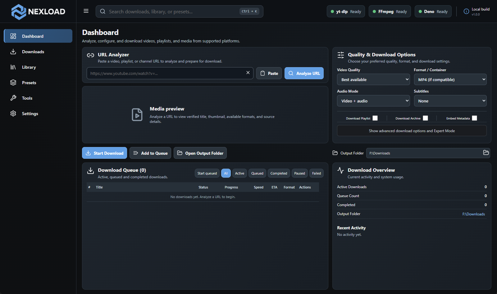
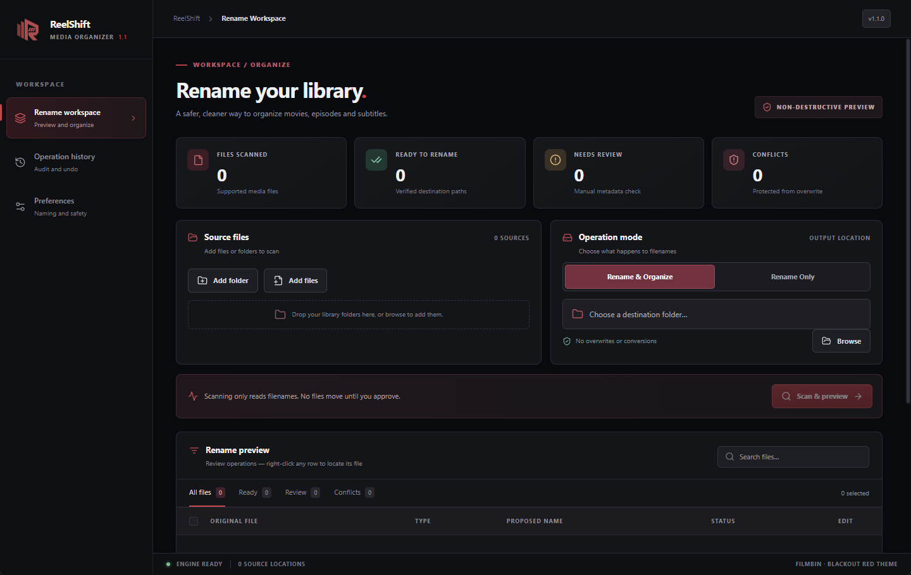

<p align="center">
  <a href="https://filejolt.github.io/" aria-label="Visit the official FileJolt website">
    <picture>
      <source media="(prefers-color-scheme: dark)" srcset="assets/brand/logo-primary.svg">
      
    </picture>
  </a>
</p>

<h3 align="center">Good software. Nothing extra.</h3>

<p align="center">
  Purpose-built Windows applications that bring order, control, and clarity to everyday file workflows.
</p>

<p align="center">
  <a href="https://filejolt.github.io/">Official Website</a> ·
  <a href="https://filejolt.github.io/software/">Our Software</a> ·
  <a href="https://filejolt.github.io/downloads/">Downloads</a> ·
  <a href="https://filejolt.github.io/updates/">Updates</a> ·
  <a href="https://filejolt.github.io/support/">Support</a>
</p>

---

## About FileJolt

**FileJolt** is the independent home for focused Windows desktop software, beginning with **NexLoad** and **ReelShift**. Each application has its own identity and purpose, while FileJolt provides one consistent place to discover the software, review releases, and find official downloads.

The goal is simple: **useful tools, straightforward information, and no unnecessary clutter.**

FileJolt offers a unified Windows installer for NexLoad and ReelShift alongside individual portable downloads.

## Software

| | NexLoad | ReelShift |
|:--|:--|:--|
| **Purpose** | Download and manage supported online media. | Preview, rename, and organize movies, TV episodes, and subtitles. |
| **Current listed release** | v1.0.0 | v1.1.0 |
| **Platform** | Windows x64 | Windows x64 |
| **Product page** | [Explore NexLoad](https://filejolt.github.io/software/nexload/) | [Explore ReelShift](https://filejolt.github.io/software/reelshift/) |
| **GitHub releases** | [Official releases](https://github.com/SleepyKevy/NexLoad/releases) | [Official releases](https://github.com/SleepyKevy/ReelShift/releases) |

<table>
  <tr>
    <td align="center" width="50%">
      <a href="https://filejolt.github.io/software/nexload/">
        
      </a>
      <br>
      <sub><strong>NexLoad</strong> · Media downloader</sub>
    </td>
    <td align="center" width="50%">
      <a href="https://filejolt.github.io/software/reelshift/">
        
      </a>
      <br>
      <sub><strong>ReelShift</strong> · Media organizer</sub>
    </td>
  </tr>
</table>

## Official Downloads

FileJolt provides **two ways to use its Windows software**: a dedicated installer or individual portable ZIP downloads. A FileJolt account is not required.

### FileJolt Installer

**`FileJolt-Setup.exe`** is the official Windows installer for **NexLoad** and **ReelShift**. It lets you select **either application or both** during setup, rather than downloading and setting up each one separately.

1. Visit the [FileJolt Downloads page](https://filejolt.github.io/downloads/) for official download information.
2. Download **`FileJolt-Setup.exe`** from the official FileJolt distribution link.
3. Run the installer and choose which applications to install.
4. Follow the setup prompts to complete installation.

The installer also provides an uninstall option for managing the installed applications.

### Portable ZIP Downloads

Prefer not to use an installer? **NexLoad** and **ReelShift** are also available as separate **Windows x64 portable ZIP archives** through their official GitHub Releases pages.

1. Open the [FileJolt Downloads page](https://filejolt.github.io/downloads/) or the relevant product's GitHub Releases page above.
2. Download the portable ZIP for NexLoad or ReelShift.
3. Extract the complete archive to a writable folder.
4. Launch the application's `.exe` file from the extracted folder.

**Windows security notice:** The installer and some application releases may not be digitally signed, so Windows SmartScreen may display a warning. Download only from official links, verify a published SHA-256 checksum when available, and review any warning before choosing whether to run the software.

For requirements and troubleshooting, see [FileJolt Support](https://filejolt.github.io/support/).

## About This Repository

This repository contains the **official FileJolt website**, published using **GitHub Pages**. It is a static site built with:

- **HTML5** for site structure and content
- **CSS3** for its responsive design and styling
- **JavaScript** for client-side interactions
- **SVG and image assets** for FileJolt, NexLoad, and ReelShift branding

The website does not require a separate application server or a build framework to serve its static pages.

### Repository Structure

```text
filejolt.github.io/
├── index.html           # Home page
├── 404.html             # Custom not-found page
├── about/               # About FileJolt
├── assets/
│   ├── brand/           # FileJolt logos and identity assets
│   ├── css/             # Website styles
│   ├── js/              # Website interactions
│   ├── nexload/         # NexLoad product assets
│   └── reelshift/       # ReelShift product assets
├── downloads/           # Official downloads and release details
├── software/            # Product directory and application pages
│   ├── nexload/
│   └── reelshift/
├── updates/             # Release updates
├── support/             # Help and troubleshooting
├── robots.txt
└── sitemap.xml
```

## Support and Issues

For questions about the website, use the [FileJolt website issue tracker](https://github.com/FileJolt/filejolt.github.io/issues). For application-specific problems, use the relevant product's tracker:

- [NexLoad issues](https://github.com/SleepyKevy/NexLoad/issues)
- [ReelShift issues](https://github.com/SleepyKevy/ReelShift/issues)

## Links

**Website:** https://filejolt.github.io/  
**Downloads (installer and portable editions):** https://filejolt.github.io/downloads/  
**GitHub organization:** https://github.com/FileJolt

---

<p align="center">
  <sub>© 2026 FileJolt. All rights reserved.</sub><br>
  <sub>Designed for clarity. Built for utility.</sub>
</p>
